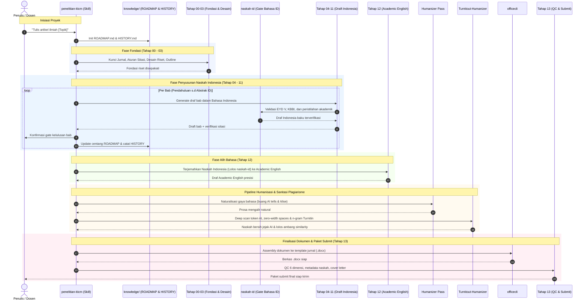

# Penelitian-ITICM

Skill alur bertahap penyusunan artikel jurnal ilmiah standar SINTA / Scopus / IEEE (Tahap 0–13 AMP Gen.03) berbasis metodologi ketat, verifikasi sumber, standardisasi bahasa Indonesia akademik, humanisasi naskah, dan sanitasi jejak AI / plagiarisme.

---

## Arsitektur & Dependensi Ekosistem

Naskah artikel ilmiah **selalu disusun terlebih dahulu dalam Bahasa Indonesia** secara utuh dan terstandarisasi sebelum diterjemahkan ke Academic English (Tahap 12). 

Skill ini mengintegrasikan repositori dan tool pendukung dari ekosistem `@ardith666`:

```
penelitian-iticm (Orchestrator Tahap 0–13)
│
├── [Tahap 00–03] Fondasi & Desain Riset
│   └── dev-methodology          → Governance & alur eksekusi (spec → plan → test)
│
├── [Tahap 04–11] Penyusunan Draft Indonesia Baku (Gate Wajib naskah-id)
│   ├── naskah-id (WAJIB)        → Penjaga kaidah EYD V, KBBI & peristilahan akademik Indonesia
│   ├── diagram-design           → Diagram alur metodologi / arsitektur penelitian (Tahap 06-07)
│   └── Zotero / DOI verifier    → Verifikasi sumber primer 5 tahun terakhir (Tahap 10)
│
├── [Tahap 12] Alih Bahasa (Academic English Translation)
│   └── English Translator       → Menerjemahkan naskah Indonesia yang sudah tervalidasi naskah-id
│
└── [Tahap 12–13] Humanisasi, Sanitasi Jejak AI & Paket Submit
    ├── humanizer (skill)        → Naturalisasi prosa & eliminasi AI tells / klise
    ├── Turnitout-Humanizer      → Sanitasi zero-AI token watermark, zero-width space & n-gram Turnitin
    └── officecli                → Assembly dokumen final .docx sesuai template jurnal
```

### Repositori Dependensi
1. **[naskah-id](https://github.com/ardith666/naskah-id)** *(WAJIB pada Tahap 04–11)*:
   - Menjadi gate bahasa utama untuk seluruh draf awal (Bahasa Indonesia).
   - Memastikan ketatnya kaidah EYD V, kebakuan kata KBBI, struktur kalimat lugas, dan peristilahan ilmiah Indonesia sebelum naskah masuk ke tahap alih bahasa.
2. **[Turnitout-Humanizer](https://github.com/ardith666/Turnitout-Humanizer)** *(WAJIB pada Tahap 12–13)*:
   - Sanitasi jejak AI tanpa LLM generatif (zero-AI rule engine).
   - Pembersihan invisible zero-width Unicode (`U+200B`, `U+200C`, `U+200D`, `U+2060`) dan C2PA metadata.
   - Disrupsi n-gram Turnitin/iThenticate/GPTZero pada berkas `.docx`, `.tex`, dan source code tanpa merusak formula, sitasi, maupun format tabel.
3. **[dev-methodology](https://github.com/ardith666/dev-methodology)**:
   - Kerangka kerja manajemen state naskah (`knowledge/ROADMAP.md` & `HISTORY.md`).
4. **[officecli](tools/officecli.md)**:
   - CLI parsing & assembly naskah format Microsoft Word (`.docx`) sesuai template jurnal target.

---

## Posisi `naskah-id` dalam Alur Gate

| Ruang Lingkup | Gate Tahap | Peran `naskah-id` | Kriteria Lolos (Gate Pass) |
|---|---|---|---|
| **Badan Utama IMRaD** | **Tahap 04 – 09** (Pendahuluan, Tinjauan, Metode, Hasil, Pembahasan, Kesimpulan) | Validasi kalimat baku, pemilihan diksi akademik, tata bahasa EYD V, eliminasi bahasa tutur/slang | Tidak ada kata non-baku KBBI, kalimat efektif, struktur logis per paragraf |
| **Daftar Pustaka** | **Tahap 10** | Penulisan nama penulis Indonesia & partikel pustaka sesuai konvensi | Format nama & singkatan konsisten |
| **Abstrak Indonesia** | **Tahap 11** | Kondensasi teks abstrak Indonesia (150–250 kata) | Ringkas, padat, lugas, memenuhi 4 elemen IMRaD |
| **Batas Alih Bahasa** | **Sebelum Tahap 12** | Menjadi prasyarat (pre-requisite) terjemahan bahasa Inggris | Naskah sumber Indonesia berstatus valid & bersih |

---

## Alur Kerja (Sequence Diagram)



---

## Tahapan Penulisan (Tahap 0–13)

| # | Tahap | File | Output Utama | Dependensi Terkait |
|---|---|---|---|---|
| 0 | Target Jurnal | `stages/tahap-00-jurnal.md` | Template & gaya selingkung terkunci | - |
| 1 | Aturan Sitasi | `stages/tahap-01-aturan.md` | Konvensi sitasi (APA/IEEE) & database | `references/format-ieee.md` |
| 2 | Desain Riset | `stages/tahap-02-desain.md` | 13 parameter desain & data mentah | - |
| 3 | Struktur IMRaD | `stages/tahap-03-struktur.md` | Outline terperinci | - |
| 4 | Pendahuluan | `stages/tahap-04-pendahuluan.md` | 5 paragraf, funnel gap, min. 10 kutipan | `naskah-id`, `verifikasi-sumber.md` |
| 5 | Tinjauan Pustaka | `stages/tahap-05-tinjauan.md` | Sintesis tematik, matriks perbandingan | `naskah-id` |
| 6 | Metode | `stages/tahap-06-metode.md` | 6 komponen reproduktif (+PRISMA jika SLR) | `naskah-id`, `prisma-slr.md` |
| 7 | Hasil | `stages/tahap-07-hasil.md` | Data objektif murni (report only) | `naskah-id`, `diagram-design` |
| 8 | Pembahasan | `stages/tahap-08-pembahasan.md` | Reverse funnel interpretasi vs literatur | `naskah-id` |
| 9 | Kesimpulan | `stages/tahap-09-kesimpulan.md` | Jawaban tujuan, limitasi, future works | `naskah-id` |
| 10 | Daftar Pustaka | `stages/tahap-10-pustaka.md` | Sitasi valid (DOI/URL aktif, Zotero ready) | `naskah-id`, `verifikasi-sumber.md` |
| 11 | Abstrak (ID) | `stages/tahap-11-abstrak.md` | 150–250 kata padat Bahasa Indonesia | `naskah-id` |
| 12 | Academic English | `stages/tahap-12-english.md` | Terjemahan formal akademik | `references/pelajaran-academic-writing.md` |
| 13 | QC & Submit | `stages/tahap-13-qc-submit.md` | QC silang, metadata, cover letter, sanitasi | `Turnitout-Humanizer`, `officecli` |

---

## Pipeline Sanitasi AI & Turnitin (Tahap 12–13)

Sebelum naskah dimasukkan ke Tahap 13 untuk paket submit, wajib melalui 2 tahap sanitasi:

1. **Humanizer Pass**:
   - Menghilangkan klise AI (*"delve into"*, *"pivotal role"*, kalimat kontras kaku, em-dash berlebihan).
   - Menyelaraskan ritme bacaan dengan nada akademik alami.
2. **Turnitout Pass ([ardith666/Turnitout-Humanizer](https://github.com/ardith666/Turnitout-Humanizer))**:
   - Memecah rangkaian contiguous n-gram pemicu kemiripan iThenticate / Turnitin.
   - Menghapus zero-width characters (`U+200B` dll) dan metadata C2PA.
   - Memastikan formula matematika LaTeX dan format XML `.docx` tidak rusak.

---

## Lisensi & Kontribusi

Dikelola di bawah ekosistem tools akademik **ITICM** oleh [@ardith666](https://github.com/ardith666).
Silakan laporkan perbaikan template atau prompt melalui repository issue.
