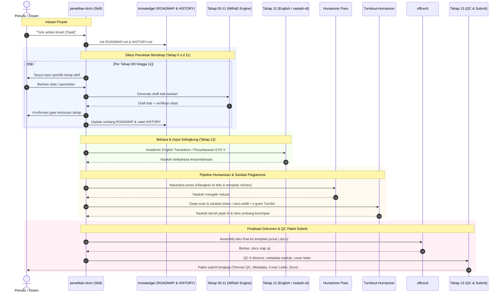

# Penelitian-ITICM

Skill alur bertahap penyusunan artikel jurnal ilmiah standar SINTA / Scopus / IEEE (Tahap 0–13 AMP Gen.03) berbasis metodologi ketat, verifikasi sumber, humanisasi naskah, dan sanitasi jejak AI / plagiarisme.

---

## Arsitektur & Dependensi Ekosistem

Skill ini mengintegrasikan repositori dan tool pendukung dari ekosistem `@ardith666`:

```
penelitian-iticm (Orchestrator Tahap 0–13)
│
├── [Tahap 00–12] Penyusunan IMRaD & Referensi
│   ├── dev-methodology          → Governance & alur eksekusi (spec → plan → test)
│   ├── naskah-id                → Standar kaidah bahasa Indonesia ilmiah (EYD V, KBBI)
│   ├── officecli                → Generator .docx berbasis template (JUTISI / IEEE / custom)
│   └── diagram-design           → Diagram alur metodologi / arsitektur penelitian
│
└── [Tahap 12–13] Humanisasi, Sanitasi Jejak AI & Paket Submit
    ├── humanizer (skill)        → Rewrite gaya penulisan agar natural & bebas AI tells
    ├── Turnitout-Humanizer      → Sanitasi deterministik token AI, zero-width space & n-gram Turnitin
    └── officecli                → Assembly dokumen final .docx siap submit
```

### Repositori Dependensi
1. **[Turnitout-Humanizer](https://github.com/ardith666/Turnitout-Humanizer)**:
   - Sanitasi jejak AI tanpa LLM generatif (zero-AI rule engine).
   - Pembersihan invisible zero-width Unicode (`U+200B`, `U+200C`, `U+200D`, `U+2060`) dan C2PA metadata.
   - Disrupsi n-gram Turnitin/iThenticate/GPTZero pada berkas `.docx`, `.tex`, dan source code tanpa merusak formula, sitasi, maupun data tabel.
2. **[naskah-id](https://github.com/ardith666/naskah-id)** *(opsional)*:
   - Standar gaya selingkung bahasa Indonesia baku akademik (EYD V, KBBI) saat penyusunan naskah awal.
3. **[dev-methodology](https://github.com/ardith666/dev-methodology)**:
   - Kerangka kerja manajemen state naskah (`knowledge/ROADMAP.md` & `HISTORY.md`).
4. **[officecli](tools/officecli.md)**:
   - CLI parsing & assembly naskah format Microsoft Word (`.docx`) sesuai template jurnal.

---

## Alur Kerja (Sequence Diagram)

Berikut alur eksekusi dari inisiasi target jurnal hingga naskah siap disubmit:



---

## Tahapan Penulisan (Tahap 0–13)

| # | Tahap | File | Output Utama | Dependensi Terkait |
|---|---|---|---|---|
| 0 | Target Jurnal | `stages/tahap-00-jurnal.md` | Template & gaya selingkung terkunci | - |
| 1 | Aturan Sitasi | `stages/tahap-01-aturan.md` | Konvensi sitasi (APA/IEEE) & database | `references/format-ieee.md` |
| 2 | Desain Riset | `stages/tahap-02-desain.md` | 13 parameter desain & data mentah | - |
| 3 | Struktur IMRaD | `stages/tahap-03-struktur.md` | Outline terperinci | - |
| 4 | Pendahuluan | `stages/tahap-04-pendahuluan.md` | 5 paragraf, funnel gap, min. 10 kutipan | `references/verifikasi-sumber.md` |
| 5 | Tinjauan Pustaka | `stages/tahap-05-tinjauan.md` | Sintesis tematik, matriks perbandingan | `naskah-id` |
| 6 | Metode | `stages/tahap-06-metode.md` | 6 komponen reproduktif (+PRISMA jika SLR) | `references/prisma-slr.md` |
| 7 | Hasil | `stages/tahap-07-hasil.md` | Data objektif murni (report only) | `diagram-design` |
| 8 | Pembahasan | `stages/tahap-08-pembahasan.md` | Reverse funnel interpretasi vs literatur | - |
| 9 | Kesimpulan | `stages/tahap-09-kesimpulan.md` | Jawaban tujuan, limitasi, future works | - |
| 10 | Daftar Pustaka | `stages/tahap-10-pustaka.md` | Sitasi valid (DOI/URL aktif, Zotero ready) | `references/verifikasi-sumber.md` |
| 11 | Abstrak | `stages/tahap-11-abstrak.md` | 150–250 kata padat + kata kunci | - |
| 12 | Academic English | `stages/tahap-12-english.md` | Terjemahan formal akademik | `references/pelajaran-academic-writing.md` |
| 13 | QC & Submit | `stages/tahap-13-qc-submit.md` | QC silang, metadata, cover letter, sanitasi | `Turnitout-Humanizer`, `officecli` |

---

## Pipeline Sanitasi AI & Turnitin (Tahap 12–13)

Sebelum naskah dimasukkan ke Tahap 13 untuk paket submit, wajib melalui 2 tahap sanitasi:

1. **Humanizer Pass**:
   - Menghilangkan klise AI (*"delve into"*, *"pivotal role"*, kalimat kontras kaku, em-dash berlebihan).
   - Menyelaraskan ritme bacaan dengan nada akademik alami.
2. **Turnitout Pass ([ardith666/Turnitout-Humanizer](https://github.com/ardith666/Turnitout-Humanizer))**:
   - Memecah rangkaian contiguous n-gram pemicu kemiripan iThenticate / Turnitin.
   - Menghapus zero-width characters (`U+200B` dll) dan metadata C2PA.
   - Memastikan formula matematika LaTeX dan format XML `.docx` tidak rusak.

---

## Lisensi & Kontribusi

Dikelola di bawah ekosistem tools akademik **ITICM** oleh [@ardith666](https://github.com/ardith666).
Silakan laporkan perbaikan template atau prompt melalui repository issue.
